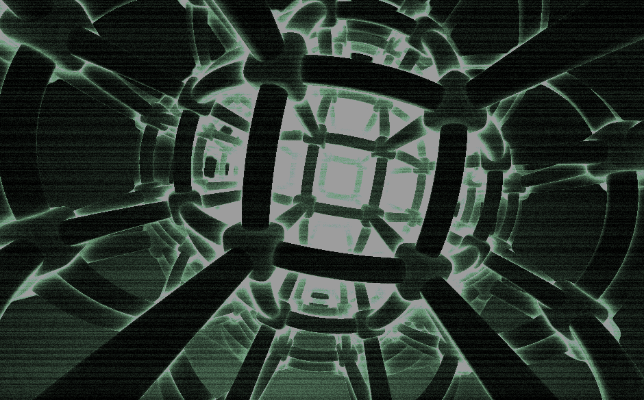
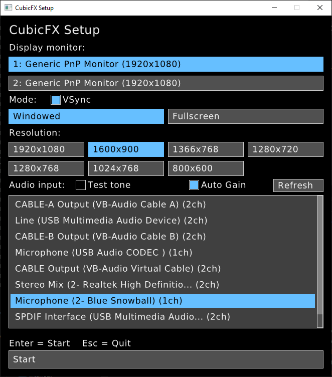

# CubicFX
BeatDetektor / raylib standalone OpenGL shader based music visualizer

[](https://dl.circleci.com/status-badge/redirect/gh/cjcliffe/CubicFX/tree/master)



This was a minimal app created for a few select parties. It was originally built
on CubicVR2/GLFW/OpenAL and has since been ported to raylib with RtAudio capture.
Recent development assistance by Muse Spark 1.3.

Many shaders are derivatives of ShaderToy or the old glsl.heroku site and may not yet contain proper attribution.

## Requirements

- CMake 3.16 or newer
- A C++17 compiler (Visual Studio 2022 on Windows)
- Internet access at configure time — raylib, RtAudio, and raygui are fetched automatically
- An audio input device (microphone, line-in, or "stereo mix") for the visuals to react to

## Build

```bat
cmake -S . -B build
cmake --build build --config Release
```

Pinned dependencies (see `CMakeLists.txt`): raylib 6.0, RtAudio 6.0.1,
and raygui (tracking master, header-only),
fetched with shallow clones. No vendored libraries or external checkouts required.

## Tests

```bat
cmake --build build --config Release
ctest --test-dir build -C Release --output-on-failure
```

## Run

Launch `CubicFX` from the build directory so it finds its `shaders/`, `png/`,
and `fonts/` asset folders, e.g. from `build/`:

```bat
CubicFX.exe
```

A setup dialog appears first — pick options, then press Start (or Enter).
`Esc` in the dialog quits.



Command-line arguments can prefill the dialog:

```
CubicFX.exe [monitor] [width height] [autoTimerLimit]
```

- `monitor` — 1-based display number
- `width height` — render resolution (applies in both modes)
- `autoTimerLimit` — seconds before auto-advancing to a random visualizer

### Setup options

- **Display monitor** — which screen the visualizer opens on
- **Mode** — windowed or fullscreen, plus a **VSync** checkbox beside the
  title to toggle vertical sync (on by default)
- **Resolution** — render resolution in both modes; fullscreen upscales it to
  the monitor's native resolution, so a lower choice runs faster
- **Audio input** — capture device list (mouse wheel or scrollbar to scroll,
  `Refresh` to re-enumerate), plus:
  - **Test tone** — synthesized signal instead of the microphone, useful for
    checking that the visuals react without needing live audio
  - **Auto Gain** — automatic input leveling for quiet sources; uncheck to use
    the raw input signal

## Controls

- Visualizer select — number keys, `Q`–`P`, `A`–`M`, brackets, `;` `'` `-` `=`
- `Space` — random visualizer and transition
- `Shift` + `1`–`6` — overlay image select, `Shift` + `0` — toggle overlay
- `Up` / `Down` — beat detector high/low range mode
- `PageUp` / `PageDown` (or `,` / `.`, `Shift` for coarse) — global alpha
- Double-click — toggle windowed/fullscreen
- `Esc` — back to setup (quit from the setup dialog)

## License

MIT, see `LICENSE`. `BeatDetektor.h` / `BeatDetektor.cpp` are GPLv3.
